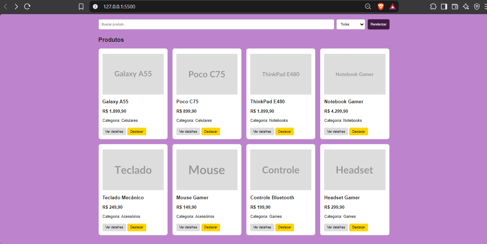
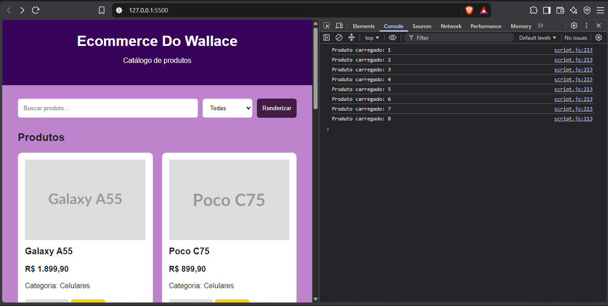

Mini Ecommerce – Catálogo em Cards

Aluno

Nome: Wallace Gabriel Moreira da Silva

Matrícula: 929805

Sobre o projeto

O projeto consiste no desenvolvimento de um mini ecommerce utilizando HTML, CSS e JavaScript.

A aplicação apresenta produtos em formato de cards e permite realizar buscas, filtrar produtos por categoria, visualizar detalhes e destacar produtos.

Funcionalidades

- Listagem de produtos
- Busca por nome
- Filtro por categoria
- Visualização de detalhes
- Destaque dos produtos
- Renderização dinâmica dos cards
- Manipulação do DOM com JavaScript

Tecnologias utilizadas

- HTML5
- CSS3
- JavaScript

Demonstração

Produtos e detalhes

 Produtos e detalhes

 Console

